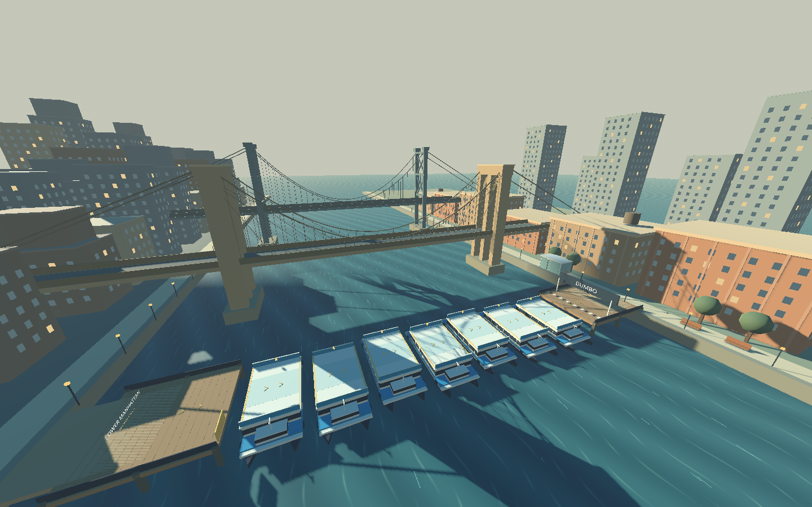
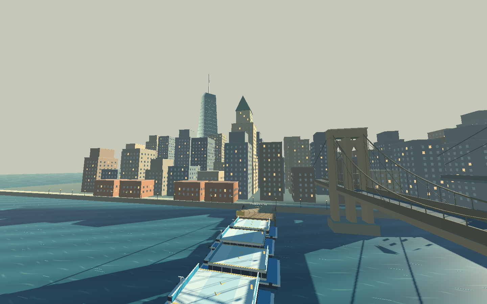
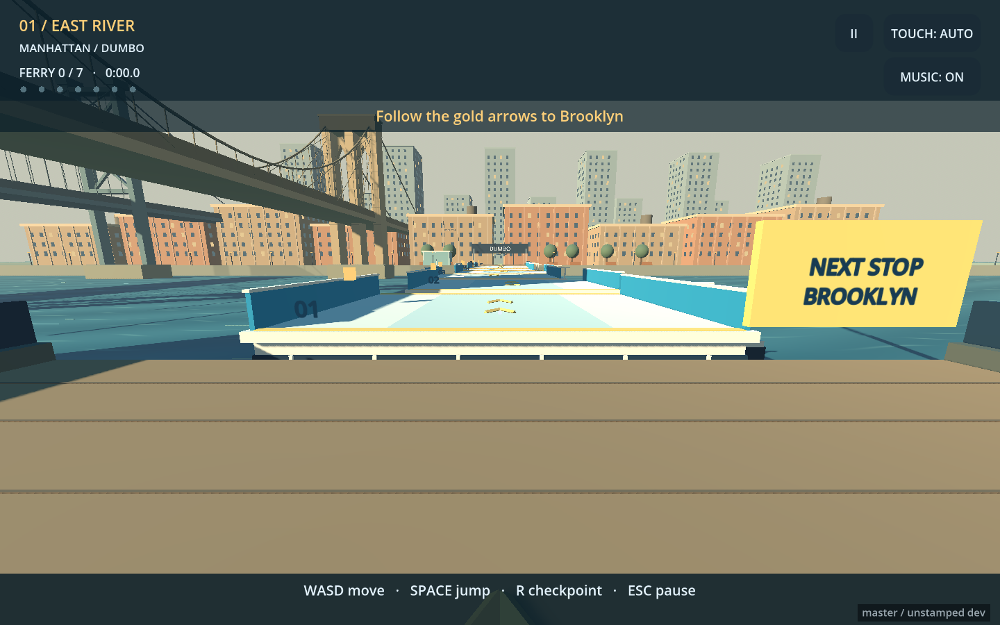

# Level One: The East River Hop

An easy first-person crossing from Lower Manhattan to DUMBO. The East River is
compressed for playability: seven stationary NYC-inspired catamarans form the
route, with the Brooklyn Bridge nearby and the Manhattan Bridge farther upriver.
This is a stylized setting, not a scale map or a real ferry service itinerary.

## Route and difficulty

- Start at the Lower Manhattan pier, cross seven ferry roofs in order, and land
  at the DUMBO finish line.
- Roofs are 12 × 8 meters at the same elevation. Most gaps are 2 meters, with a
  3-meter final gap. Small lateral offsets still leave a straight, wide route.
- Normal forward movement and one jump cross every gap. No air strafing,
  bunny-hop speed, moving-platform timing, or narrow rail landings are required.
- Each grounded roof landing saves a centered checkpoint. Flying above a ferry,
  landing on its lower deck, or skipping boats does not advance progress.
- Water immediately returns the player to the latest checkpoint. Manual reset
  uses that same checkpoint. There is no life limit or countdown.
- Arrival after the seventh ferry shows the completion screen, crossing time,
  and splash count. Replay resets the entire crossing. Pause freezes progress.

## Setting

The Brooklyn Bridge has stone towers, twin pointed portals, suspension cables,
and diagonal stays. The Manhattan Bridge uses blue-gray steel towers with cross
bracing. The Manhattan shore has layered high-rises, a faceted One World Trade
Center silhouette and spire, older stepped towers, and seaport warehouses.
The DUMBO shore has brick warehouses, rooftop water tanks, a park promenade,
trees, benches, and a small carousel pavilion. A frog waits near the far bank.

All geometry is generated locally; no downloaded art or new runtime packages
are needed. City windows and static box details use MultiMesh batches. Water
uses a lightweight opaque shader. Ferry collision roofs remain stationary.

## Files

- `scenes/main.tscn`: default level, lighting, sky, player, and HUD.
- `scripts/level_one.gd`: route, checkpoints, completion, procedural scenery.
- `scripts/river.gdshader`: animated river surface.
- `scripts/hud.gd`: level instructions, progress, completion, and input controls.
- `scenes/playground.tscn`: original movement lab, retained as a regression fixture.

## Verification

Use Godot 4.7.2, matching CI:

```sh
godot --headless --path . --editor --import
godot --headless --path . tests/level_one_test.tscn
godot --headless --path . tests/controller_test.tscn
godot --headless --path . tests/citizen_test.tscn
python3 -m unittest discover -s tests -p 'test_*.py'
```

The level integration scene runs real physics across every gap and checks safe
checkpoint activation, water recovery, pause, completion, out-of-order landings,
manual reset, touch replay, and the generic play gesture used by gamepad A.
It exits nonzero on failure and runs in CI before web export.

Capture repeatable desktop, portrait, landscape, skyline, and completion views:

```sh
godot --path . --audio-driver Dummy --script res://tools/capture_level_one.gd
```

This requires a rendering display; use `xvfb-run -a` on a Linux CI host with X11
libraries, or `--display-driver wayland` in a Wayland session. Images are written
to `build/verification/`, which is ignored by Git. Selected review images are
retained below. The capture tool uses fixed camera positions; it does not replace
the real-physics crossing tests. Physical phone and gamepad testing remains useful.

An optional Chromium smoke run uses an existing Playwright installation:

```sh
godot --headless --path . --export-release Web build/web/index.html
python3 -m http.server 8751 --bind 127.0.0.1 --directory build/web
# In another terminal (set PLAYWRIGHT_MODULE if Playwright lives elsewhere):
node tools/check_level_one_web.cjs
```

This saves desktop and mobile screenshots, Playwright traces, and a JSON error
report under `build/verification/`. Browser interactions cover startup, movement,
jumping, pause, and a 390 × 844 CSS-pixel touch layout at device scale factor 2.
Review the images for visible outcomes; the script checks loading and browser
errors, while `level_one_test.tscn` asserts actual gameplay outcomes.






